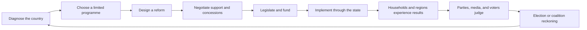

<!-- /autoplan restore point: C:/Users/pc/.gstack/projects/PoliticalSimGame/unknown-autoplan-restore-20260821-160943.md -->
# Ardenia: Mission to Early Access

**Document status:** Living product and development mission  
**Established:** 18 August 2026  
**Current stage:** Systems alpha  
**Intended release:** Paid Early Access, Ardenia-only  
**Primary question:** What must Ardenia become before strangers can buy it, understand it, and want to play another campaign?

---

## 1. Purpose of this document

This document is the canonical development mission for taking Ardenia from its current systems-alpha state to a credible Early Access release. It combines the current design audit, the diagnosis of the player experience, the intended identity of the game, the work that should be prioritised, the work that should be postponed, and the release gates that must be met before money is charged.

It is deliberately not a list of every possible feature. Ardenia already contains more simulation than its current player experience can comfortably communicate. The task is to turn those systems into a coherent political career rather than continuously widening the simulation.

Every proposed feature should be tested against this document. If a feature does not strengthen the core political cycle, improve the player's understanding of consequences, or help the game reach an Early Access gate, it should normally wait.

---

## 2. The mission

Ardenia will become a political-economy simulation about governing, opposing, reforming, and living with the consequences inside one fragile post-Union democracy.

The player will not merely select laws and receive modifiers. They will diagnose national problems, choose priorities, construct reforms, negotiate political support, fund institutions, manage implementation, observe how different households and regions experience policy, and face judgment in parliament and at elections. Losing office will not end the game. It will change the player's authority, tools, obligations, and route back to power.

The defining player fantasy is:

> I lead a political party through government and opposition in a country whose institutions, households, regions, parties, and neighbours continue to change. My promises can become laws, my laws can fail in administration, and the consequences become the politics of the next election.

The Early Access mission is complete when a new player can finish an election cycle, explain what they tried to accomplish, understand why it succeeded or failed, and immediately imagine a different strategy for another campaign.

---

## 3. Product identity

### 3.1 What Ardenia is

Ardenia is:

- A single-player political and state-management simulation.
- A simulation of one deeply authored country rather than a shallow global sandbox.
- A continuous political career across government and opposition.
- A game about the distance between policy intention and lived results.
- A parliamentary simulation in which parties, blocs, coalitions, ministries, regions, households, and foreign pressures interact.
- A deterministic political economy where core outcomes come from tracked conditions, while uncertainty and randomness create developments, personalities, and crises.
- A game of constrained priorities, negotiated commitments, incomplete information, and institutional capacity.

### 3.2 What Ardenia is not

Ardenia is not:

- A linear interactive novel with correct dialogue choices.
- A collection of temporary stat bonuses presented as reforms.
- A world-conquest or map-painting game.
- A generic country simulator with interchangeable nations.
- A daily micromanagement game in which every economic variable moves every day.
- A game that must simulate everything before it becomes enjoyable.
- A promise that all nine world countries will become playable during Early Access.
- A copy of Suzerain, Democracy, or a Paradox grand-strategy title.

Ardenia may share recognizable forms with those games, but its identity comes from combining parliamentary politics with administrative delivery, regional inequality, household experience, and a continuing party career.

### 3.3 The deliberate scope

Ardenia is the only player country for the Early Access release. The other countries remain world actors, diplomatic partners, threats, markets, creditors, and participants in regional crises. They are not missing campaigns. They are part of Ardenia's strategic environment.

The product should present this scope confidently. It should not begin by showing the player eight disabled countries and asking them to focus on the only available one.

---

## 4. Current-state verdict

The game is presently a strong systems alpha rather than an Early Access product.

Its internal simulation has moved well beyond a prototype. Budgets, ministries, laws, modifiers, households, regions, party blocs, elections, opposition, world actors, diplomacy, events, and persistence interact through a tested shared engine. The architecture is healthy enough to support substantial development without requiring a rewrite.

The principal weakness is not a lack of systems. It is that the player sees the machinery as many separate screens, statistics, currencies, and buttons while the most important causal relationships remain hidden. The simulation is stronger than the game currently built around it.

A likely public reaction to the current build would be:

> There is a fascinating simulation underneath this, but I do not know what I am expected to do, which information matters, or why the country changed.

That is not a safe foundation for a paid public launch. Early reviews tend to describe the experience at launch, not the potential of the architecture.

### 4.1 Current technical baseline

At the establishment of this document:

- The full engine and terminal smoke suite exits successfully.
- The headless GUI suite passes 21 of 21 checks when modal dialogs are patched for offscreen execution.
- Government and opposition campaigns construct, advance, save, load, and survive elections.
- The major risk is player comprehension and campaign structure, not basic simulation integrity.

This baseline must not be treated as permanent. Every milestone must preserve or improve it.

---

## 5. The core governing cycle

All major development should strengthen the following loop:

The game already contains substantial parts of this loop. Diagnosis exists in the reform-objective system. Negotiation partly exists in lobbying and faction relations. Legislation and funding exist. Implementation exists through ministries. Lived outcomes exist through households and regions. Elections exist.

The missing work is to connect these pieces into one visible, persistent political project.

### 5.1 Required player experience

At any point, the player should be able to answer five questions without reading source code or opening every page:

1. What are the country's most important problems?
2. What is my party or government currently trying to accomplish?
3. Which decisions are waiting for me, and when are they due?
4. Why did the important indicators change?
5. How will the country judge my record?

If the player cannot answer these questions, adding another variable or event will usually make the game worse rather than better.

---

## 6. Full mechanical audit

### 6.1 Time and pacing

**Current state:** The GUI uses a daily clock with pause and five speed settings. Most heavy simulation runs on monthly pulses. Opposition government legislation uses more detailed day-based timing.

**Strength:** Daily time gives the game a living rhythm and allows future deadlines, negotiations, votes, summits, strikes, and campaign events to occupy a political calendar.

**Weakness:** Most days do not currently contain a meaningful development. The player often watches the date advance until a monthly update or modal interruption.

**Direction:** Keep economic and household simulation primarily monthly. Make days meaningful through scheduled politics rather than daily statistical noise. The calendar should show upcoming votes, committee stages, coalition reviews, budget deadlines, diplomatic meetings, regional visits, strike deadlines, and election events. Quiet intervals should fast-forward cleanly.

### 6.2 Macroeconomy

**Current state:** GDP, sectoral growth, structural growth, inflation, unemployment, debt, deficits, workforce quality, bureaucracy, trade, loans, and modifiers interact in a bounded monthly simulation.

**Strength:** Economic results emerge from conditions and delayed effects instead of one-step stat mutations. Structural inflation and modifier timing provide memory without unbounded accumulation.

**Weakness:** The player mostly sees national aggregates. Sectoral and distributional mechanisms are difficult to anticipate before acting.

**Direction:** Do not add many more headline indicators. Connect existing sectors to reform instruments, employment groups, regional economies, imports, exports, energy exposure, and ministry workload. Forecast major directions before decisions and explain material movements afterward.

### 6.3 Annual budget

**Current state:** The player drafts eight spending envelopes, submits the plan to parliament, may lobby for it, and activates it in January. Failure produces a reduced continuing budget. Opposition players do not exercise fiscal authority.

**Strength:** The budget is a real annual political and administrative settlement rather than an instant collection of sliders.

**Weakness:** Adjusting eight envelopes in percentage steps is laborious. The screen does not sufficiently communicate strategic tradeoffs, service consequences, ministry capacity, coalition demands, or reform commitments.

**Direction:** Preserve the fiscal model but redesign the decision around priorities and commitments. The player should begin with a baseline, see unavoidable obligations, fund current reforms, identify cuts or revenue measures, and receive a clear summary of winners, risks, parliamentary support, and delivery consequences.

### 6.4 Ministries and state capacity

**Current state:** Six ministries have funding, leadership, workload, capacity, backlog, and delivery. Laws, regional programmes, treaties, sanctions, loans, crises, and ordinary administration create workload. Backlog persists and clears gradually.

**Strength:** This is one of Ardenia's strongest and most distinctive systems. It models the difference between passing policy and successfully governing. Institutional weakness creates delayed, persistent consequences.

**Weakness:** The player usually discovers overload after performance deteriorates. The responsible workload and likely future pressure are not visible enough during policy design.

**Direction:** Double down. Every important proposal should identify its responsible ministry, initial and continuing workload, expected delivery, and the consequences of overload. Ministries should present a short operational assessment rather than only a ledger. Administrative reform should be capable of changing capacity, processes, corruption exposure, and regional reach.

### 6.5 Household economy

**Current state:** Six social groups live separately in six regions. They track nominal and real income, living costs, job security, public-service access, hardship, and confidence. These feed approval, unrest, and regional incumbent support while respecting whether the player is in government or opposition.

**Strength:** This may become Ardenia's signature simulation. Economic conditions have distributional victims and beneficiaries. National recovery can coexist with household hardship and regional decline.

**Weakness:** Much of this depth is hidden in the Briefing page. The player cannot yet construct sufficiently targeted policies around these groups, so the layer risks becoming invisible complexity.

**Direction:** Put household effects at the centre of reform design, implementation reporting, political feedback, and elections. The game should routinely identify which groups and regions are gaining or losing and why. Do not turn groups into individual units to micromanage.

### 6.6 Regions and the Ardenia map

**Current state:** Six canonical regions track unemployment, pressure, state reach, political control, party support, defining issues, and active programmes.

**Strength:** Politics has a geography. The map can show how the same government is experienced differently across the country.

**Weakness:** Regional programmes are another fixed catalog of effect bundles. Regional political actors are largely absent.

**Direction:** Integrate regional investment into reform and budget design. Add a limited number of persistent regional officeholders or administrations who possess demands, information, implementation capacity, and political influence. Use the map as the main spatial explanation of household conditions, state reach, elections, and programme delivery.

### 6.7 Reform objectives

**Current state:** Seven objectives are diagnosed from live conditions. The player may adopt and later replace an objective, including in opposition. The chosen objective records the evidence present when it was adopted.

**Strength:** This is the correct foundation for the future policy system. Reform begins with a purpose grounded in the simulated country rather than a pre-written bonus.

**Weakness:** The system currently ends at intent. There are no instruments, targeting choices, compromises, draft construction, implementation plan, or evaluation.

**Direction:** Complete this system before substantially expanding fixed content. Reform design must become the central way that the player transforms diagnosis into action.

### 6.8 Legislation

**Current state:** The game supports bill proposals, political-capital costs, ideology, faction votes, bloc rebellions, lobbying, constitutional thresholds, executive orders, repeal, and implementation modifiers.

**Strength:** Parliamentary arithmetic is already connected to party structure and administrative consequence. Constitutional and statutory routes behave differently.

**Weakness:** Ten fixed laws remain the true policy agenda. After players learn them, they become predictable and exhaustible. The player mostly negotiates votes after selecting a completed proposal.

**Direction:** Use existing laws as templates and test cases for the reform builder. Future bills should be generated from objectives, instruments, scope, funding, negotiated amendments, and route. Parliament should shape the proposal before the final vote.

### 6.9 Parties and internal blocs

**Current state:** Parties contain authored blocs with ideology, loyalty, cohesion, policy biases, seat shares, rebellions, and leadership dynamics.

**Strength:** Parties are not monolithic ideological points. Internal disagreement can affect legislation, stability, and leadership.

**Weakness:** Blocs are still experienced mostly as coefficients and prose. The player rarely negotiates with a persistent bloc representative or makes a commitment that the bloc later remembers.

**Direction:** Give each politically important bloc a visible spokesperson and a small memory of promises, humiliations, concessions, and achievements. Keep the number of relationships manageable. Blocs should matter most around reform design, leadership, coalition policy, and election strategy.

### 6.10 Coalitions

**Current state:** After elections, parties are automatically assembled into a majority by ideological proximity. Coalition cohesion then contributes to stability and legislative performance.

**Strength:** Government formation remains logically stable and country-neutral.

**Weakness:** One of parliamentary politics' most consequential moments is automatic. There is no programme agreement, ministry negotiation, confidence-and-supply arrangement, or player decision about accepting junior office.

**Direction:** Make government formation playable. Parties should negotiate shared objectives, red lines, cabinet representation, budget promises, and review points. Agreements must persist and breaches must have consequences.

### 6.11 Cabinet and political people

**Current state:** Ministers have portfolio, faction, competence, loyalty, ambition, and personality traits. Appointment and dismissal affect factions and delivery. Threatening ministers may resign or participate in the schemer arc.

**Strength:** Cabinet selection links personal politics to institutional performance.

**Weakness:** Most ministers remain stat packages after appointment. Only a few traits generate continuing political narratives.

**Direction:** Add relationship memory and a limited set of context-driven behaviours. Ministers should advocate for their departments, resist unfunded commitments, seek credit, object to coalition concessions, leak during disputes, and build records. Avoid creating dozens of shallow characters.

### 6.12 Elections

**Current state:** Regional turnout, party support, ideology, thresholds, and largest-remainder seat allocation produce deterministic results. Snap elections and government changes are supported.

**Strength:** Election results arise from tracked conditions rather than an arbitrary roll. Regional politics matters.

**Weakness:** Campaigning and issue definition are thin. Government formation is automatic. The post-election result does not yet provide a complete judgment of the preceding term.

**Direction:** Make elections the culmination of the governing cycle. The campaign should be fought over a limited number of salient issues, records, promises, regional battlegrounds, and party credibility. The result must produce a political retrospective and coalition negotiation.

### 6.13 Opposition play

**Current state:** Opposition players can establish pledges, build credibility, campaign, maintain a shadow cabinet, and support, oppose, or amend government bills. The AI government owns executive authority and introduces legislation.

**Strength:** Losing office is a change of role, not a game over. This supports a multi-election political career.

**Weakness:** Opposition remains more reactive than programmatic. It cannot yet design a sufficiently complete alternative government or negotiate prospective alliances.

**Direction:** Allow opposition reform projects to become manifesto commitments. Shadow ministers should develop expertise and records. Opposition parties should coordinate or compete, choose wedge issues, and prepare coalition positions before an election. Winning office should convert prepared objectives, personnel, and promises into governing obligations.

### 6.14 Events and narrative arcs

**Current state:** Events support role-aware audiences, conditions, cooldowns, one-time firing, gated options, scheduled follow-ups, and branching chains. Existing arcs include Vetrenka, Vasca, leadership threats, and world developments.

**Strength:** The writing gives human and historical meaning to systemic conditions. Events respect whether the player possesses government authority.

**Weakness:** Modal situations can dominate the rhythm. Default responses can allow the event system to carry an otherwise inactive campaign. Some events manufacture drama instead of dramatizing conditions produced by the simulation.

**Direction:** Reserve modal events for decisions that belong to the player, have a meaningful deadline, and branch materially. Convert lower-stakes flavour into dispatches. Prefer events whose trigger and options refer to visible household, regional, coalition, administrative, diplomatic, or personal conditions.

### 6.15 Diplomacy and the world

**Current state:** The player may improve relations, sign trade agreements, request loans, condemn governments, form defense pacts, impose sanctions, hold summits, and exit treaties. World actors pursue agendas and plans independently.

**Strength:** Foreign countries possess persistent state and do not wait for the player. Treaties, loans, sanctions, and trade create continuing commitments.

**Weakness:** Diplomacy has many verbs but relatively shallow negotiations. Much of the world simulation has little visible relevance after the move to an Ardenia-focused map.

**Direction:** Do not add more countries for breadth. Deepen Ardenia's dependencies: energy, trade corridors, foreign credit, defense guarantees, border pressure, sanctions, refugees, Krasovan coercion, and Vetrenka mediation. Summits and treaties should involve concrete demands and concessions.

### 6.16 Civil war and internal conflict

**Current state:** Civil-war risk derives deterministically from instability, hostile factions, grievances, unrest, majorities, and insurgency. Crossing the threshold creates an ongoing catastrophe with recurring penalties.

**Strength:** War pressure emerges from tracked political conditions rather than a random event.

**Weakness:** Once conflict begins, it is mostly a recurring penalty state. Territorial control, elite alignment, negotiation, legitimacy, displacement, and administrative collapse remain limited.

**Direction:** This is a post-Early Access expansion unless Vetrenka requires a narrower version. Before adding tactical warfare, model political control, ceasefires, mediation, displacement, state reach, and faction alignment. Ardenia should remain a political simulation, not become a battlefield-management game.

### 6.17 Backgrounds and leadership actions

**Current state:** Backgrounds provide recurring abilities with costs and cooldowns. The player can address the nation in several tones.

**Strength:** Character creation has continuing mechanical relevance.

**Weakness:** Many abilities behave like temporary buffs, repeating the design problem of fixed reforms.

**Direction:** Backgrounds should primarily change access, information, relationships, negotiating leverage, and available approaches. An economist might receive a better fiscal forecast, a union leader might begin with trusted labour contacts, and a former general might access security channels while facing civilian suspicion. They should not merely become buttons pressed every cooldown.

### 6.18 Press, dispatches, and explanation

**Current state:** Structured news generates front pages, headlines, briefs, named actors, and varied dispatch prose. Turn summaries show selected national deltas. The engine's bounded monthly causal digest is consumed by both front-ends and kept visually separate from the public newspaper.

**Strength:** Ardenia has a consistent political voice and can dramatize a living country.

**Weakness:** The press often reports what happened more clearly than the game explains why it happened. The player's own administrative understanding is missing from the monthly presentation.

**Direction:** Integrating the causal digest is the highest-priority quality-of-life change. Separate public narrative from internal analysis: the newspaper says how the country talks about the month; the government or opposition briefing says what actually moved, why, and what requires attention.

### 6.19 Persistence and legacy

**Current state:** Saves are manually versioned and tolerant of older missing fields. A GovernmentLegacy model exists with milestones and career counters, but it is not yet maintained fully or shown in a conclusion.

**Strength:** The persistence foundation is cautious and supports long campaigns.

**Weakness:** The campaign currently lacks a durable retrospective and a clear sense of political authorship.

**Direction:** Complete the legacy system before Early Access. Record time in office and opposition, elections, reforms, promises, institutional changes, regional and household outcomes, democratic conduct, territorial settlements, and major relationships. Present a meaningful review after elections and a larger career summary after several cycles.

---

## 7. Genuine competitive strengths

### 7.1 Policy is not delivery

Ardenia already models the idea that passing a law does not make it real. Funding, ministerial leadership, state reach, workload, and backlog determine delivery. This should be treated as a headline feature, not an obscure subsystem.

### 7.2 National statistics contain different lived realities

Households and regions experience inflation, employment, income, services, and recovery differently. This gives the game a more credible political economy than a simple collection of national meters.

### 7.3 Political defeat does not end political life

Government and opposition share one continuing simulation. A player can inherit problems, lose office, prepare an alternative, and return with promises shaped by the prior term.

### 7.4 Parties contain politics

Internal blocs, cohesion, rebellions, loyalty, and leadership mean party labels are not complete explanations. This can support ideological and personal conflict without requiring scripted story routes.

### 7.5 Ardenia is authored closely enough to matter

The post-Union settlement, Vetrenka, regional inequality, inherited institutions, party origins, and external threats create a specific political present. The game can deliver replayability by changing political choices inside this country rather than by changing country names.

### 7.6 The simulation is bounded and testable

Modifiers phase in and expire, important outcomes are deterministic, both front-ends share action logic, persistence is explicit, and the smoke suites cover a wide mechanical surface. This is a valuable foundation for an Early Access game that will continue changing.

---

## 8. Principal weaknesses to solve

### 8.1 There are many actions but no sufficiently visible agenda

The game exposes dozens of operations across legislative, cabinet, diplomatic, factional, leadership, opposition, regional, budget, and reform categories. These are tools. They do not yet form a readable government programme.

The player needs a small number of persistent priorities that organize those tools and create a record.

### 8.2 Causality is hidden

The engine can calculate why approval, stability, ministry delivery, regional pressure, household hardship, and the budget moved. That explanation is not surfaced as the monthly governing report.

This is not optional polish. Causal feedback is part of the rules of a simulation game.

### 8.3 Inaction is too viable

Seeded no-action audits showed political capital reaching its cap and remaining there. A government could take very few deliberate actions, allow events and passive drift to carry the campaign, and still make a strong electoral gain. Opposition inactivity produced some credibility decline and lost seats, but not a severe organizational reckoning.

The game must distinguish patient government from absent government. Unused political capacity, neglected diagnosed problems, broken promises, inactive ministries, and a missing programme should become politically legible.

### 8.4 Too many adjacent metrics compete for attention

Approval, stability, political capital, faction loyalty, party support, bloc cohesion, credibility, hardship, confidence, regional pressure, state reach, ministry capacity, delivery, backlog, and civil-war risk are individually defensible. Together, without hierarchy, they overload the player.

The interface should classify them as outcomes, political judgment, governing ability, and threats. Secondary figures should remain available in drill-down views.

### 8.5 Political bargaining is thinner than political calculation

The game calculates votes, cohesion, thresholds, and support well. It has less depth in the promises, amendments, portfolios, side payments, public arguments, and long-term commitments that produce those numbers.

The next political systems should add bargaining rather than more arithmetic.

### 8.6 Content catalogs are finite

Fixed laws, regional programmes, repeatable diplomatic verbs, and background abilities will become solved menus. The objective is not to write hundreds of replacements. It is to create systems that compose existing content into different political projects.

---

## 9. The new-player danger list

The most likely reasons a new player will stop are, in order:

1. They do not know what to do first or what success means.
2. They see numbers change without understanding why.
3. Every page appears equally important.
4. They cannot forecast the major consequences of a decision.
5. The daily clock contains long stretches of waiting.
6. Events interrupt them without fitting a visible agenda.
7. An election happens, but coalition formation and political judgment are automatic.
8. Eight disabled countries make the game look incomplete before Ardenia has been experienced.
9. Background and leadership actions feel like routine buff buttons.
10. They finish a term without receiving a meaningful account of what they changed.

Every closed playtest should explicitly investigate these risks.

---

## 10. Design pillars

### Pillar I: Consequences must travel through institutions

Major policy should require authority, funding, administrative capacity, time, and political support. Effects should not appear merely because a button was pressed.

### Pillar II: National outcomes must have distribution

Whenever practical, an economic or service outcome should identify affected households and regions. National averages summarize consequences; they do not replace them.

### Pillar III: Politics must remember commitments

Parties, blocs, coalition partners, stakeholders, and voters should remember important promises, concessions, betrayals, and delivered achievements.

### Pillar IV: Authority follows office

Government and opposition must receive different decisions and tools. The player may influence the country from opposition, but cannot exercise state power they do not possess.

### Pillar V: The player should understand before being judged

The game may preserve uncertainty, incomplete information, and unintended consequences. It must still explain the known direction, responsible institution, major risks, and eventual causal outcome.

### Pillar VI: Fewer deep actors are better than many shallow actors

Persistent ministers, bloc representatives, coalition leaders, regional figures, and foreign counterparts should matter repeatedly. New named people require a continuing role, not merely a paragraph.

### Pillar VII: Ardenia is the centre of scope

World simulation, lore, diplomacy, and crises should be evaluated by how they affect Ardenian decisions. More world content is not automatically more game.

---

## 11. Highest-priority quality-of-life work

### P0: Required before wider testing

1. **Monthly causal report.** Call the existing digest after the monthly pulse and display up to five material explanations in both front-ends.
2. **Unified decision queue.** Classify required, urgent, planned, optional, blocked, and informational items with deadlines.
3. **Political calendar.** Show scheduled votes, budget stages, negotiations, meetings, events, and elections.
4. **First ninety days.** Guide a new player through choosing a programme, reading conditions, making a decision, and observing consequences.
5. **Action forecast.** Show likely votes, political cost, fiscal effect, ministry load, household and regional direction, and major uncertainty.
6. **Clear authority.** Label government, opposition, party, cabinet, and parliamentary decisions consistently.
7. **Automatic pause rules.** Pause for mandatory decisions and important deadlines, not every flavour development.

### P1: Required before Early Access

1. An Agenda view organized around objectives and commitments rather than mechanical categories.
2. Search, filtering, and compact summaries for policies, parties, ministries, and diplomatic commitments.
3. Concrete explanations for disabled actions and the steps required to unlock them.
4. A reform and promise timeline showing design, negotiation, passage, implementation, evaluation, and electoral status.
5. Notification controls that allow players to demote low-priority information.
6. Clear autosave state, save naming, version information, and save export for bug reports.
7. Metric glossary and causal breadcrumbs linking a result to the responsible policy or condition.
8. Common display scaling and resolution checks.

### P2: Valuable during Early Access

1. Player-configurable briefing emphasis.
2. Comparative regional and household history graphs.
3. Reopenable monthly and election reports.
4. Campaign notes or pinned objectives.
5. More extensive keyboard navigation and accessibility settings.

---

## 12. The reform system required for Early Access

Reform design is the central pre-release mechanical project.

### 12.1 Reform stages

Every major reform should pass through these stages:

1. **Diagnosis:** The live simulation identifies the problem and its severity.
2. **Objective:** The player adopts a durable purpose.
3. **Instruments:** The player chooses regulatory, fiscal, ownership, service, labour, investment, or administrative tools.
4. **Scope:** The player chooses breadth, targeting, speed, duration, and territorial reach.
5. **Costing:** The game estimates fiscal cost, revenue, ministry workload, and external dependencies.
6. **Consultation:** Coalition partners, party blocs, ministries, and stakeholders state demands and objections.
7. **Compromise:** The player accepts amendments, concessions, delays, exemptions, or political conflict.
8. **Authority:** The project becomes legislation, a budget commitment, an administrative programme, an executive measure, or a combination.
9. **Implementation:** Ministry delivery, funding, state reach, time, and resistance determine actual effects.
10. **Evaluation:** After six, twelve, and twenty-four months, the game compares the objective's original diagnosis with current evidence.
11. **Judgment:** Parties, stakeholders, regions, households, media, and voters interpret the record.

### 12.2 Minimum reform breadth for Early Access

At least four substantially different reform families must be complete:

- Restore household purchasing power.
- Secure work and modernise productive activity.
- Rebuild public services and state capacity.
- Reduce regional and land inequality.

Fiscal sustainability may be a fifth family or a cross-cutting constraint affecting the other four.

Each family must support at least three recognizably different approaches. Different approaches must change coalitions, distribution, administration, fiscal consequences, and implementation risk—not merely the size of one modifier.

### 12.3 Reform success is not bill passage

A reform may succeed politically and fail administratively. It may improve its target while producing unacceptable fiscal or regional costs. It may be technically successful and electorally unpopular. The evaluation must preserve these distinctions.

---

## 13. Coalition politics required for Early Access

### 13.1 Formation

After an election, the player must be able to participate in structured coalition talks when their party is relevant. Negotiable elements should include:

- Shared reform objectives.
- Cabinet portfolios.
- Budget commitments.
- Constitutional red lines.
- Foreign-policy commitments.
- Review dates.
- Formal coalition versus confidence and supply.
- Entry as leading or junior partner.

### 13.2 Coalition agreement

The final agreement must become persistent game state and a visible document. Partners should judge the player against it. A promise should not disappear into a one-time loyalty delta.

### 13.3 Coalition life

Coalition partners should:

- Demand progress on agreed priorities.
- Object when their ministries are underfunded.
- Seek amendments to reforms.
- Threaten abstention, rebellion, or departure.
- Receive or lose credit for shared achievements.
- Reopen negotiations after shocks or leadership changes.

### 13.4 Coalition breakdown

Breakdown should create several possible outcomes rather than immediately forcing the same path every time:

- Renegotiation.
- Replacement partner.
- Minority government.
- Confidence-and-supply agreement.
- Caretaker period.
- Snap election.

---

## 14. Political actors and stakeholder expansion

This expansion should follow the completed reform and coalition systems, because actors need meaningful objects over which to negotiate.

The minimum useful stakeholder set is:

- Organized labour.
- Employers, major firms, and banks.
- Agricultural and land interests.
- Regional administrations.
- Civil-service leadership.
- Security and veterans' interests.
- Independent press and legal institutions.

Stakeholders should provide or withhold cooperation, information, legitimacy, access, and implementation assistance. They should make specific demands connected to live reforms. They should not become another row of approval meters that can be raised by spending political capital.

---

## 15. Diplomacy and external-pressure expansion

Early Access diplomacy should concentrate on a smaller number of relationships with substantial consequences.

Priority external issues are:

- Vetrenka's political and territorial future.
- Krasovan pressure and influence.
- Energy supply and prices.
- Trade corridors and export markets.
- Foreign credit and loan conditions.
- Defense guarantees and treaty obligations.
- Border security, refugees, and displacement.
- Sanctions and compliance.

A diplomatic agreement should state what each party gives, receives, and risks. Foreign policy should feed the budget, ministries, sectors, households, regions, parties, and coalition agreement.

Additional countries, additional generic relation actions, and playable foreign campaigns are not pre-Early Access priorities.

---

## 16. What should be removed, hidden, or consolidated

### 16.1 Remove from the normal player flow

- The disabled country-selection list. Replace it with a confident Ardenia campaign premise.
- The seed field. Retain it under Advanced Options for reproducibility.
- Low-stakes modal situations that can be dispatches.
- Excess secondary metrics from the main dashboard. Preserve them in drill-down views.
- A visible no-background option unless it is deliberately presented as a challenge mode.

### 16.2 Consolidate

- Court Faction, Campaign, Address the Nation, and similar generic actions should become contextual operations attached to actual political problems and relationships.
- Regional programmes should eventually enter the reform and investment framework rather than remain a separate fixed-effect catalog.
- Alerts, briefing recommendations, deadlines, and available decisions should feed one decision queue.
- Minor world actors should remain simulated but appear prominently only when relevant to Ardenia.
- Raw ministry, household, and regional data should be summarized first and expanded on demand.

### 16.3 Retire after replacements exist

- The fixed ten-law proposal menu after the reform builder can produce equivalent policies.
- Old global-map runtime code after the Ardenia-only map direction is fully committed and no migration work depends on it.
- Generic background buff buttons after backgrounds affect information, access, relationships, and negotiating options.
- Temporary loyalty purchases that have no remembered political reason.

### 16.4 Do not remove

- Household simulation.
- Ministry capacity, delivery, and backlog.
- Regional inequality and state reach.
- Party blocs and rebellions.
- Opposition play.
- Delayed modifiers.
- Country-neutral engine boundaries.
- World simulation that creates real pressure on Ardenia.

These are foundational even when their presentation should become quieter.

---

## 17. Roadmap to Early Access

The roadmap is organized around player-facing milestones, not arbitrary feature counts.

### Milestone 0: Mission baseline

**Goal:** Establish the product direction and protect the working simulation.

**Deliverables:**

- This mission document becomes the canonical roadmap.
- Current automated tests remain green.
- Major new work is evaluated against the governing cycle.
- No new playable-country scope is introduced.

**Exit criteria:**

- Development tasks can be assigned to a named milestone below.
- Features that do not contribute to a milestone are explicitly deferred.

### Milestone 1: The country explains itself

**Goal:** Make the existing simulation understandable without developer knowledge.

**Deliverables:**

- Monthly causal digest connected to GUI and CLI.
- Internal monthly report separated from the newspaper front page.
- Unified decision queue.
- Political calendar with deadlines and future events.
- First ninety-day guided programme.
- Action forecasts for laws, budget choices, programmes, and major diplomacy.
- Clear metric hierarchy and authority labels.
- Automatic-pause rules.

**Acceptance criteria:**

- A new player can identify the three most important current problems.
- A new player can explain the leading cause of a material monthly change.
- Required decisions cannot be mistaken for background information.
- The player can see the next important scheduled political date.
- No important action presents an unexplained cost or disabled state.

**Release state after milestone:** Closed systems alpha.

#### Milestone 1 progress — 18 August 2026

- **Complete — Monthly causal digest.** The same read-only digest reaches the GUI and terminal after monthly simulation, visually separate from public dispatches and the newspaper.
- **Complete — Unified decision queue foundation.** Government and opposition obligations share stable priorities, authority, destinations, and deadlines. The dashboard shows required and urgent work; the GUI and terminal briefings show the wider queue.
- **Complete — Political calendar foundation.** The GUI and terminal show known public dates for decisions, monthly reports, government legislative windows, fiscal rollover, elections, regional-programme conclusions, and loan maturities without revealing hidden event follow-ups.
- **Complete — First ninety-day guided programme.** Government and opposition each receive three role-specific programme choices. A selected programme tracks three achievements made through existing policy, parliamentary, party, cabinet, leadership, and regional actions; it appears in both Briefings, feeds the shared queue and calendar, survives save/load through campaign metadata, expires cleanly, and applies no hidden effects.
- **Partial — Action forecasts.** Parliamentary vote projections and the annual budget's ministry forecast exist; reform, household, regional, and major diplomatic forecasts remain incomplete.
- **Partial — Metric hierarchy and authority.** Queue entries state authority and priority, but the wider dashboard still gives too many adjacent metrics equal visual weight.
- **Partial — Automatic pause rules.** Elections, pending situations, and new opposition-facing government bills pause the clock; the rule is not yet driven generically by required queue deadlines.

**Next Milestone 1 deliverable:** drive automatic-pause behaviour from the shared required-decision queue, replacing the remaining system-specific pause checks.

### Milestone 2: One complete reform journey

**Goal:** Prove the entire governing cycle with one vertical slice.

**Deliverables:**

- One reform family supports objective, instruments, scope, costing, consultation, compromise, authority, implementation, evaluation, and judgment.
- Household and regional beneficiaries are forecast and reported.
- Ministry workload and delivery are forecast and reported.
- Coalition and bloc reactions respond to proposal content.
- The reform persists as a named political project.
- Opposition can prepare the project without exercising state authority.

**Acceptance criteria:**

- Two players can pursue the same objective through recognizably different reforms.
- Bill passage does not guarantee delivery.
- Evaluation can distinguish technical, administrative, fiscal, political, and electoral outcomes.
- The reform becomes part of the player's record and the next election.

**Release state after milestone:** Closed feature alpha.

### Milestone 3: Government is negotiated

**Goal:** Turn elections and coalitions into playable political transitions.

**Deliverables:**

- Structured post-election coalition talks.
- Persistent coalition agreement.
- Cabinet and programme negotiation.
- Formal coalition and confidence-and-supply options.
- Coalition review, dispute, renegotiation, and breakdown paths.
- Government and opposition authority transitions preserve programmes, people, and promises.
- First meaningful election retrospective.

**Acceptance criteria:**

- More than one viable government can emerge from plausible election results.
- The player may rationally reject office or accept junior office.
- Coalition promises affect later votes and stability.
- Losing office produces a coherent opposition state rather than an empty period.

### Milestone 4: Reform breadth and political society

**Goal:** Create enough systemic breadth for replayable full campaigns.

**Deliverables:**

- At least four complete reform families.
- Persistent representatives for the most important blocs and stakeholders.
- Contextual consultation and resistance.
- Regional actors connected to implementation and support.
- Backgrounds affect access, information, and options rather than primarily buffs.
- Low-value fixed and repeatable actions are consolidated.

**Acceptance criteria:**

- At least three substantially different governing strategies are viable.
- Different reforms create different coalitions of household, regional, party, and stakeholder support.
- No one fixed sequence dominates routine playtests.
- Stakeholders matter through cooperation and resistance rather than purchasable approval.

### Milestone 5: A full political career

**Goal:** Make a complete election cycle satisfying and continued play meaningful.

**Deliverables:**

- Election campaigns organize around salient issues, records, and promises.
- Government inactivity and neglected objectives produce political consequences.
- Political-capital overflow no longer makes prioritization irrelevant.
- Opposition programmes convert into governing obligations after victory.
- Election and term retrospectives use a functioning legacy record.
- Players may continue through multiple elections.
- Vetrenka and at least one major economic or institutional crisis can intersect the normal governing cycle.

**Acceptance criteria:**

- A new player can complete the first election cycle without developer assistance.
- The election result can be explained through the preceding record.
- A defeated player has immediate strategic decisions in opposition.
- A victorious player inherits promises, coalition obligations, and administrative conditions.
- A largely inactive government cannot reliably prosper without an explainable external reason.

**Release state after milestone:** Public playtest candidate.

### Milestone 6: Early Access hardening

**Goal:** Turn the complete game loop into a dependable paid product.

**Deliverables:**

- Readable dashboard and system pages at supported resolutions and scaling levels.
- Save compatibility policy, visible versioning, autosave recovery, and save export.
- Ten-year automated campaign stress tests.
- Government and opposition soak tests across elections.
- Performance and crash review.
- Bug-report workflow.
- New-player documentation and controls reference.
- Honest store description and Early Access roadmap.
- Public demo or Steam Playtest feedback addressed.

**Acceptance criteria:**

- No known save-corruption issue.
- No campaign-blocking input or modal issue.
- No action silently spends resources without applying its declared consequence.
- Common campaigns survive several elections and save/load cycles.
- External testers primarily request more breadth and depth rather than basic explanation.
- The team can state exactly what Early Access contains and what 1.0 still requires.

**Release state after milestone:** Paid Early Access candidate.

---

## 18. Early Access release gates

Early Access should not be triggered by a date alone. All of the following gates must be satisfied.

### 18.1 Core-loop gate

- Diagnosis through electoral judgment works as one connected cycle.
- At least four reform families are complete.
- Coalition formation and maintenance are playable.
- Government and opposition are both active roles.
- One full election cycle feels like a culmination rather than a timer expiration.

### 18.2 Comprehension gate

- Players understand what requires attention.
- Monthly material changes receive causal explanations.
- Decisions show their known major tradeoffs.
- The first ninety days teach the governing cycle contextually.
- The interface distinguishes outcomes, political judgment, governing ability, and threats.

### 18.3 Content gate

- Ardenia supports at least three meaningfully different campaign strategies.
- Every region matters mechanically.
- Household distribution is visible in policy and political outcomes.
- Vetrenka or another major national question provides a substantial strategic arc.
- Events support the simulation rather than carrying the campaign by themselves.

### 18.4 Technical gate

- No known save corruption.
- Autosave recovery works.
- Save migrations cover routine Early Access updates.
- Ten-year automated runs remain bounded and complete.
- Both front-ends pass their test suites.
- Government and opposition survive multiple elections.
- All player actions respect authority.
- Common resolutions and display scaling are usable.
- Version and save-schema information are visible.

### 18.5 Playtest gate

- At least 70% of unassisted testers complete the first ninety days.
- At least 50% voluntarily reach the first election during the applicable test window.
- Most testers can state their programme in their own words.
- Fewer than 20% describe major outcomes as random or fundamentally unexplained.
- Players demonstrate several different strategies.
- The dominant requests concern expansion and depth, not basic navigation or comprehension.

### 18.6 Product gate

- The store page presents Ardenia-only scope honestly.
- The Early Access roadmap does not promise uncommitted playable countries.
- Players can report bugs and supply saves.
- Known limitations are documented.
- The price reflects the content available at launch rather than hypothetical future content.

---

## 19. External playtest programme

### Stage I: Closed systems alpha

**Audience:** Ten to fifteen players who already enjoy political or economic simulations.

**Questions:**

- Can they complete the first year?
- Can they explain important changes?
- Do they understand ministry delivery?
- Can they describe a governing strategy?
- Does at least one decision create genuine hesitation?
- Where do they stop reading?

### Stage II: Wider private alpha

**Audience:** Thirty to fifty players, including people who have not followed development.

**Questions:**

- Can they finish the first ninety days without assistance?
- Do they use the decision queue and calendar?
- Do government and opposition both feel active?
- Can they distinguish passing a reform from delivering it?
- Which metrics do they misunderstand?
- Are different strategies emerging?

### Stage III: Public demo or platform playtest

**Audience:** Players encountering Ardenia without personal explanation.

**Questions:**

- Why do they stop?
- Do they stop because the test has shown enough, or because they are confused or bored?
- Do they want another strategy, another campaign, or merely more content?
- Which promises do they infer from the store description?
- Are bugs reproducible from exported saves?

The critical readiness signal is that requests shift from “help me understand the game” to “give me more ways to play it.”

---

## 20. Risks and countermeasures

### Risk: The game becomes a spreadsheet

**Cause:** More visible metrics, forecasts, household groups, ministries, and regions.

**Countermeasure:** Present a prioritized conclusion first, with optional drill-down. Every screen must answer a player question rather than merely expose state.

### Risk: Reform design becomes a content explosion

**Cause:** Writing unique text and effects for every combination.

**Countermeasure:** Build composable instruments, scopes, stakeholders, and implementation rules. Author special cases only when they produce distinctive politics.

### Risk: Political capital remains an action currency

**Cause:** Every political interaction priced as a separate button.

**Countermeasure:** Connect political capacity to agenda bandwidth, negotiation commitments, leadership attention, and opportunity cost. Review whether every action requires a direct PC payment.

### Risk: Daily time creates dead air

**Cause:** Monthly simulation with few scheduled political dates.

**Countermeasure:** Use the calendar for political process, allow clean fast-forward, and avoid adding meaningless daily economic rolls.

### Risk: Events overpower simulation

**Cause:** Frequent modal choices and authored effect bundles.

**Countermeasure:** Make events interpret live conditions, reserve modals for material authority, and move flavour into dispatches.

### Risk: World scope consumes Ardenia development

**Cause:** Nine complete country data sets and country-neutral engine capability encourage expansion.

**Countermeasure:** Treat other countries as actors in Ardenia's strategic environment until the Ardenian career loop is complete and commercially proven.

### Risk: Early Access is used to finish the core game

**Cause:** The simulation appears technically stable enough to release early.

**Countermeasure:** Do not charge until the full diagnosis-to-election cycle is coherent. Use closed tests and public playtests to finish the core experience. Use paid Early Access to expand and refine a game that is already satisfying.

---

## 21. Decision rules for future features

Before approving a new mechanic, answer:

1. Which stage of the governing cycle does it strengthen?
2. What new decision does the player make?
3. Which existing systems consume its output?
4. How will the player understand its cause and effect?
5. Does it create a persistent commitment or only a temporary bonus?
6. Can the mechanic work in both government and opposition where appropriate?
7. Does it deepen Ardenia or widen scope?
8. What existing surface or action can it replace?
9. How will it be tested?
10. Which Early Access gate does it advance?

A feature that cannot answer these questions should normally be postponed.

---

## 22. Definition of done for a mechanic

A mechanic is not complete when its model and engine code exist. It is complete when:

- The player knows why and when to use it.
- Its authority is correct in government and opposition.
- Its costs and known risks are forecast.
- Its result travels through existing systems.
- Its material consequences are explained afterward.
- It persists correctly where required.
- It has bounded long-run behaviour.
- It appears in the appropriate retrospective or political record.
- Both front-ends access the same underlying operation where applicable.
- Automated tests cover direct mechanics, integration, persistence, and regressions.

---

## 23. What can wait until after Early Access

The following are valid roadmap ideas but are not release prerequisites:

- Playable foreign countries.
- A global map.
- Tactical civil-war warfare.
- Hundreds of additional events.
- Portraits and extensive character art.
- Voice acting.
- Extensive animation.
- A complete soundscape.
- Every reform objective having equal content breadth.
- Every world country having deep bilateral negotiations.
- Resolution of every historical mystery.
- Perfect balance across every possible ideology.

Early Access should expand a complete Ardenian political career, not ask customers to wait for that career to become coherent.

---

## 24. Immediate next milestone

Development should now begin with **Milestone 1: The country explains itself**.

The digest, shared decision queue, public political calendar, and role-specific first ninety-day programme are now implemented. The recommended remaining order is:

1. Drive required-decision pause behavior from the shared queue instead of individual hard-coded checks.
2. Add forecasts to one high-value vertical slice, beginning with the active reform objective.
3. Reorganize the main information hierarchy around outcomes, political judgment, governing ability, and threats.
4. Test the new opening with players who have never read the project documentation.

No additional major simulation subsystem should be introduced before these remaining items make the current game materially easier to understand.

---

## 25. Final release principle

Ardenia will be ready for Early Access not when it has simulated the most things, but when the things it already simulates create a political story the player can understand, influence, and own.

The release test is:

> A stranger completes an election cycle. They can explain what they promised, what they attempted, whom they persuaded, where the state failed, which people benefited, why the election moved, and what they would do differently next time.

When that experience is reliable, Ardenia can enter Early Access with a clear identity, an honest scope, and a strong foundation for expansion.
